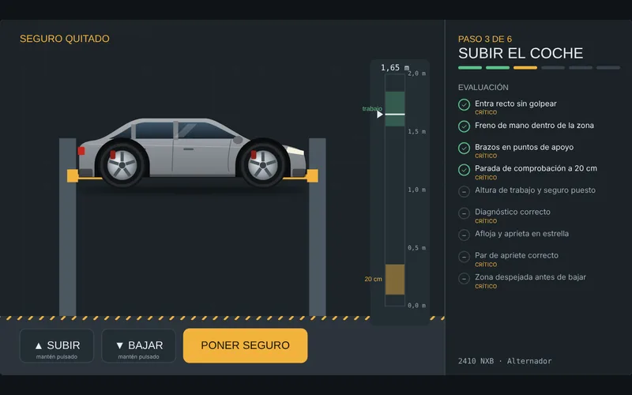

# Taller Twin

Simulador de diagnóstico de averías. Una jornada de 8 coches: el cliente solo cuenta lo que nota («hace un ruido raro», «le cuesta arrancar», «echa humo») y tú tienes que descubrir **todo** lo que tiene el coche, como en un taller de verdad.

**Jugar:** https://zitroolrac.github.io/taller-twin/

## Las pruebas

- **En el suelo:** arrancar con la llave (arranque lento, solo «clic», ralentí que tiembla), acelerar (chillido de correa, escape como un tractor, tirones), frenar (chirrido, vibración, pedal esponjoso), girar el volante («clonc», «clac-clac», gemido de la dirección), cuadro de instrumentos con testigos, humo del escape (azul, blanco o negro), empujar la carrocería, presión y desgaste del neumático, faros prueba de luces (cruce, freno, intermitentes, marcha atrás, limpiaparabrisas) y escáner OBD con escaneo de todos los sistemas (motor, cambio, ABS, airbag, carrocería, climatización), códigos y datos en vivo.
- **Bajo el capó** (cada pieza sale y se ve de cerca con una animación): batería con multímetro (parado y en marcha), varilla del aceite (nivel y color), depósitos de refrigerante, líquido de frenos y de dirección, correa, filtro de aire, bujía o calentadores, cuerpo de mariposa, turbo, manguitos, caja de fusibles (filamento de cada fusible) y olor.
- **Ruedas, una a una:** presión con manómetro, dibujo del neumático (se ve el desgaste), llanta y frenos. Cada rueda se revisa por separado: lo que mires en una no cuenta para las otras. Para encontrar un pinchazo lento quitas los 5 tornillos, metes la rueda en una cubeta de agua y la giras hasta ver burbujas.
- **Cada coche es distinto:** gasolina o diésel, con o sin turbo, con o sin sensores de desgaste de pastillas, con o sin sensores de presión (TPMS), frenos traseros de disco o de tambor, dirección hidráulica o eléctrica, y aire acondicionado manual o climatizador automático.
- **Climatización:** temperatura del aire en la rejilla con A/C, calefacción y modo automático, manómetros de alta y baja y el embrague del compresor.
- **Prueba en carretera:** por baches (bieleta, muelle, amortiguador) y a 100 km/h (llanta doblada, alineación, pinchazo, zumbido de rodamiento, embrague que patina).
- **Empujar delante y detrás** para saber qué eje tiene el amortiguador gastado.
- **Despiece de la suspensión** con el coche levantado, rueda por rueda: muelle, amortiguador, bieleta, rótulas, fuelle, rodamiento y sensor ABS.
- **Por debajo:** escape, filtro de partículas (diésel), cárter, cremallera y gotas en el suelo según su color.

## 59 averías

Frenos (pastillas, discos alabeados, falta de líquido), motor (bujía o bobina, filtro de aire, junta de culata, segmentos, fugas de aceite, correa, EGR, fuga de vacío, bomba de gasolina, caudalímetro, inyector, cuerpo de mariposa, turbo, calentadores, embrague), sensores (cigüeñal, árbol de levas, distribución variable, MAP, picado, temperatura del refrigerante, sonda lambda), escape (catalizador, filtro de partículas, escape roto), electricidad (batería, alternador, motor de arranque), refrigeración (manguito, termostato, ventilador), suspensión y dirección (amortiguador, muelle, bieleta, rótula, homocinética, rodamiento, bomba de dirección, EPS), ruedas (pinchazo, llanta, alineación, desgaste, pila del sensor TPMS), ABS y airbag, climatización (falta de gas, compresor, trampilla de mezcla, sensor de temperatura interior) y luces y fusibles.

Desde el tercer coche puede haber dos averías a la vez, y hay falsas alarmas: las gotas transparentes sin olor son agua del aire acondicionado y no son avería. Al firmar el informe, el juego te explica qué pistas delataban cada avería.

## Cómo está hecho

JavaScript puro y Canvas 2D, sin dependencias, en un único `index.html`: modelo de averías con un resultado normal para cada prueba y modificadores por avería, combinación de varias averías, partículas (humo, vapor, gotas), sonido sintetizado con Web Audio (motor, arranque, correa, frenos, dirección, escape) y mandos táctiles de pulsación sostenida.

## Autor

Carlo Prado Ortiz · [Portafolio](https://zitroolrac.github.io/Portfolio/)

## El escáner, como en un taller

- Escaneo de 8 sistemas (motor, cambio, ABS, presión de neumáticos, airbag, dirección asistida, carrocería, climatización); el código de ABS o TPMS dice qué rueda es con códigos **activos** e **históricos** y **datos congelados**.
- **Datos en vivo** del motor: régimen, temperatura, tensión, sonda lambda, ajuste de combustible, presión de gasolina o del rail, caudal de aire, EGR (consigna y real), presión del colector, presión del turbo y hollín del filtro de partículas. Se puede acelerar mientras se miran.
- **Borrar códigos y volver a arrancar:** solo vuelven los fallos reales.
- Un código no dice la pieza: un P0171 puede ser una fuga de vacío, la bomba de gasolina o el caudalímetro, y se confirma con los datos en vivo y mirando el coche.
- La dirección hidráulica no tiene centralita; la eléctrica (EPS) sí da códigos.
- Las fugas a veces gotean y a veces solo dejan manchas en el cárter, la cremallera o los manguitos.
